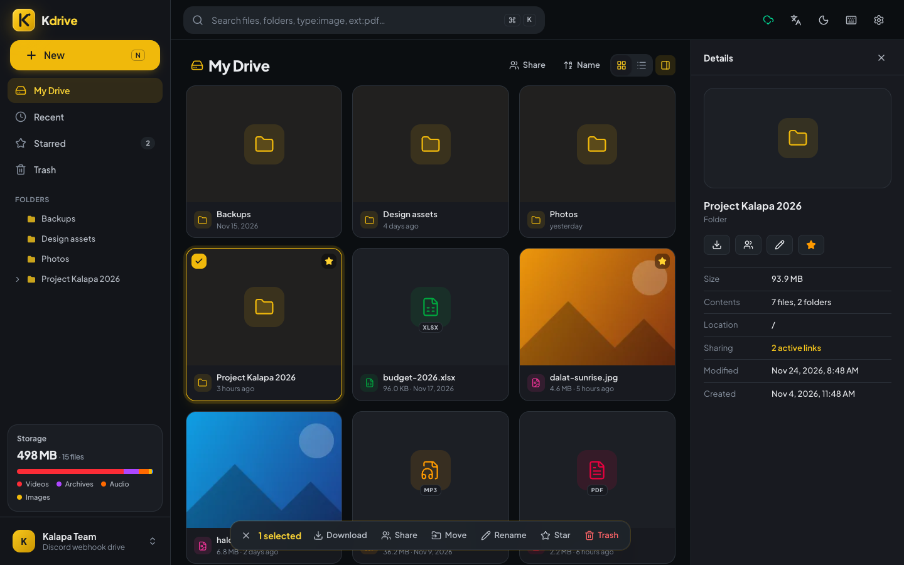
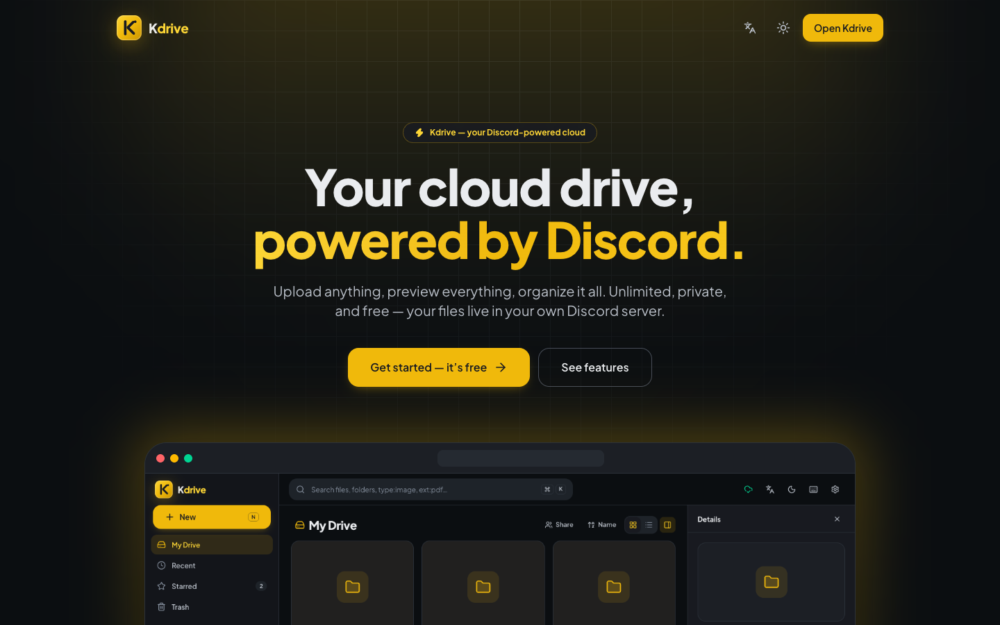
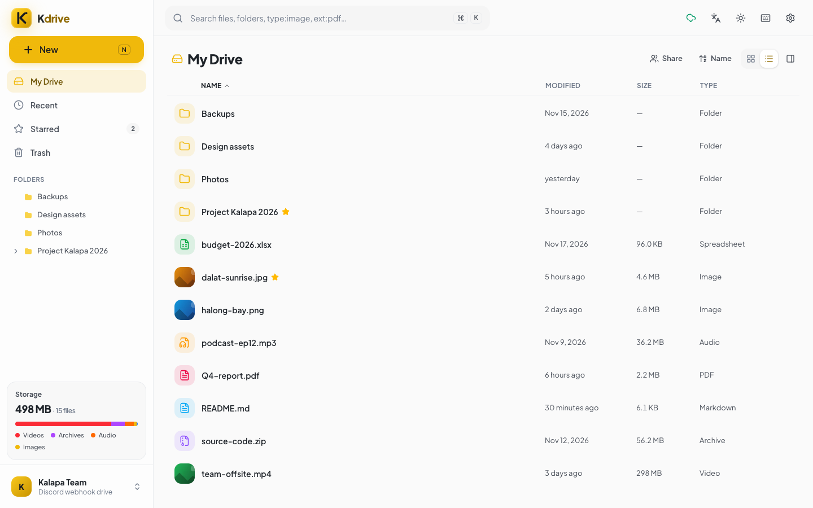
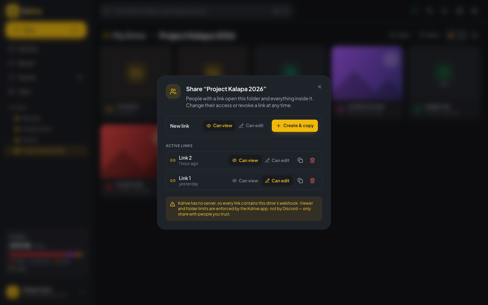
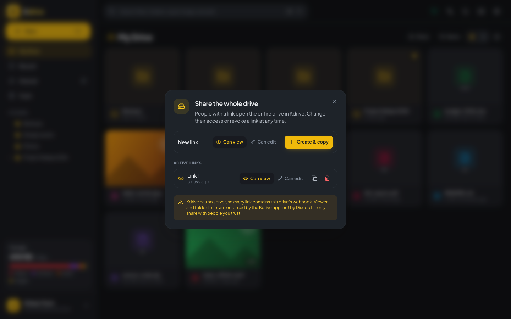
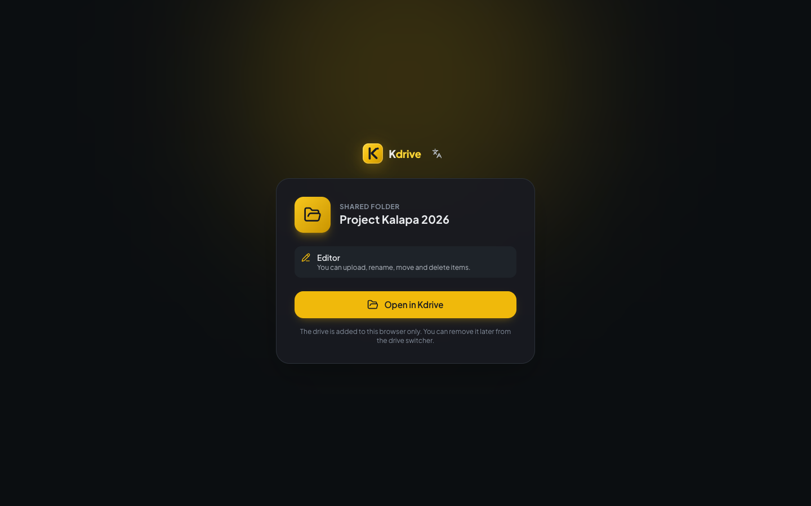
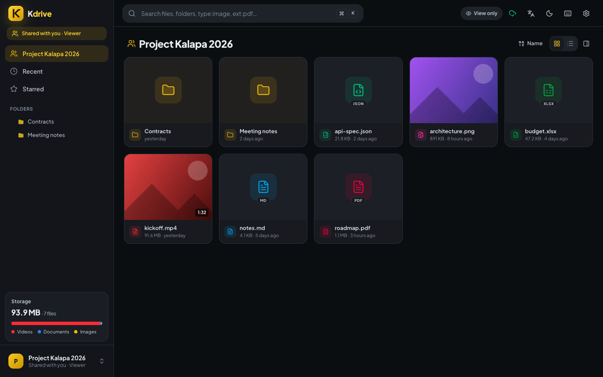
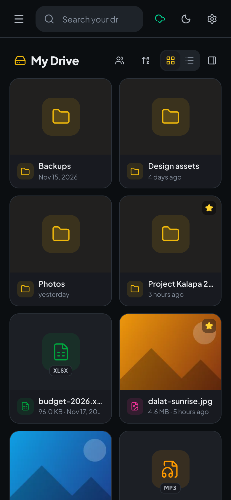
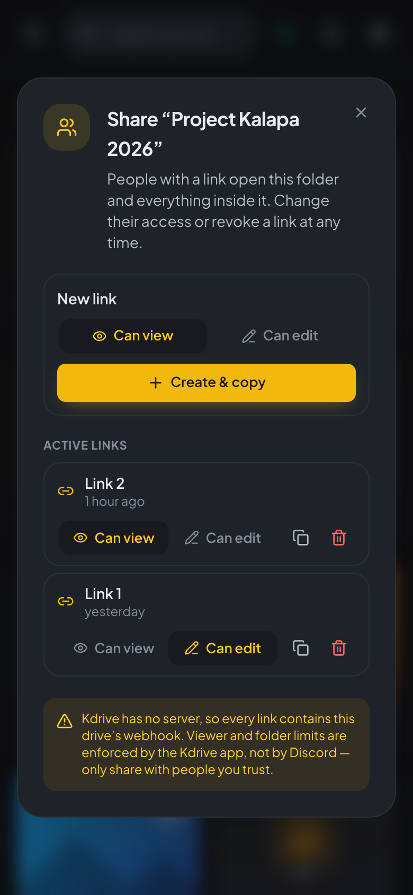

# Kdrive Desktop

**An unlimited cloud drive that stores your files on Discord, as a native app for macOS, Linux and Windows.** Upload any file, preview it, organize it into folders, and share it. Everything lives in your own Discord server. There is no backend and nothing to sign up for.

This is the desktop build of the [Kdrive web app](https://github.com/ntdat104/kdrive): the same React code, logic and UI, wrapped with **Tauri v2** (Rust + the OS webview), so the installer is small and the app starts fast. Drives, share links and invite links are fully compatible between the web app and the desktop app.

Built with **Tauri 2, Vite 8, React 19, TypeScript, and Tailwind CSS 4**.



## Screenshots

<table>
  <tr>
    <td width="50%"><br><sub><b>Landing page</b></sub></td>
    <td width="50%"><br><sub><b>List view, light theme</b></sub></td>
  </tr>
</table>

### Sharing folders and the whole drive

Create invite links for a folder, or for the entire drive, as **Can view** or **Can edit**. You can switch each link between view and edit, copy it again, or revoke it at any time.

<table>
  <tr>
    <td width="50%"><br><sub><b>Share a folder:</b> one link per person or group, each with its own access level</sub></td>
    <td width="50%"><br><sub><b>Share the whole drive</b> from the drive switcher, the toolbar, or ⌘K</sub></td>
  </tr>
  <tr>
    <td width="50%"><br><sub><b>Opening an invite link</b> shows the folder and the access level before the drive is added</sub></td>
    <td width="50%"><br><sub><b>Viewer:</b> only the shared folder is visible, and every write action is hidden</sub></td>
  </tr>
</table>

### Mobile

<p>
  
  &nbsp;
  
</p>

## Features

| | |
|---|---|
| 📦 **Any file, any size** | Files are split into chunks that fit Discord's upload limit (10 MB, or 50/100 MB on boosted servers). Uploads run in parallel and handle rate limits automatically. |
| 📁 **Real file manager** | Folders (each new one gets its own accent color; change it anytime), folder upload, drag & drop (from the OS and between folders), move, rename, make a copy, star, trash with restore and undo, and recursive delete |
| 👀 **Previews** | Images (zoom, pan, rotate), video, audio, PDF, code with syntax highlighting, rendered Markdown, and fonts. ←/→ moves through the gallery. Grid thumbnails are generated at upload time. |
| ⚡ **Quick previews** | Big images and videos open instantly in low quality (≤1600 px / 480p, encoded in the browser at upload), then switch to the original once it has downloaded. Video keeps playing from the same spot. (Video renditions need WebCodecs: macOS and Windows have it; on Linux, WebKitGTK skips them.) |
| ✏️ **Edit in place** | Built-in CodeMirror editor for text, code, and Markdown files. Ctrl/⌘+S saves a new version. |
| 🔍 **Search** | Instant search with filters: `type:image`, `ext:pdf`, `is:starred`, `size>100mb`, plus a ⌘K command palette |
| ⬇️ **Downloads** | Streams to disk through the native save dialog. Folders and multi-selects download as a streamed ZIP. |
| 🔗 **Share links** | Anyone with the link can download, with no account. The data sits in the URL fragment, never on a server. |
| 👥 **Share folders & whole drives** | Invite links open a folder (or the entire drive) in Kdrive as **Viewer** or **Editor**. Switch a link between view and edit, or revoke it, at any time. |
| 🔐 **End-to-end encryption** | Optional AES-256-GCM with a PBKDF2 passphrase. File contents *and* names are encrypted. |
| ⌨️ **Keyboard-first** | Arrow navigation, Shift/Ctrl selection, marquee selection, F2, Del, Space quick look, and more (press `?`) |
| 🌐 **Vietnamese & English** | Vietnamese by default. Switch from the top bar, Settings → Appearance, or the landing page. Dates and sizes follow the language. |
| 🎨 **Polished UI** | Light, dark, and system themes plus 7 accent colors (yellow — the Binance-style default — orange, green, blue, red, purple, indigo), motion, and responsive layouts from mobile to desktop |
| 🔁 **Multi-drive and multi-device** | One webhook = one drive. Switch drives anytime. Open the same drive anywhere with just the webhook URL. Edits from two devices are detected as conflicts. |
| ♻️ **Disbox v1 import** | Import your files from the original Disbox app in one click |

## Install

Download the installer for your OS from the **[Releases page](https://github.com/ntdat104/kdrive-app/releases/latest)**, or grab the latest build of any commit from **Actions → Build → Artifacts**.

| OS | Files |
|---|---|
| **macOS** (Intel + Apple Silicon) | `Kdrive_<version>_universal.dmg` |
| **Linux** | `Kdrive_<version>_amd64.AppImage` · `.deb` · `.rpm` |
| **Windows** | `Kdrive_<version>_x64-setup.exe` · `Kdrive_<version>_x64_en-US.msi` |

The builds are **unsigned**, so each OS warns on first launch:

- **macOS:** drag Kdrive into Applications, then right-click it → **Open** → **Open**. If macOS still refuses: `xattr -dr com.apple.quarantine /Applications/Kdrive.app`
- **Linux:** `chmod +x Kdrive_*.AppImage && ./Kdrive_*.AppImage`, or `sudo apt install ./Kdrive_*.deb` / `sudo dnf install ./Kdrive-*.rpm`. Video playback uses GStreamer (`gstreamer1.0-plugins-good`, `gstreamer1.0-libav`).
- **Windows:** SmartScreen → **More info** → **Run anyway**. WebView2 ships with Windows 10/11.

Then:
1. In Discord, create a private server → channel settings → **Integrations → Webhooks → New Webhook → Copy URL**.
2. Open Kdrive, paste the URL, optionally set an encryption passphrase, and start uploading.

## What differs from the web app

Everything in the feature list works the same. The desktop shell only replaces the parts a browser tab gets from its host:

| | Web app | Desktop app |
|---|---|---|
| Reading files from Discord's CDN | `/__cdn` proxy on the server, or a Cloudflare Worker | Built-in proxy on `127.0.0.1` (random port + secret path token, Discord CDN hosts only). Nothing to deploy. |
| Downloads | `showSaveFilePicker` on Chromium, a Blob elsewhere | Native save dialog, streamed to disk chunk by chunk on every OS |
| Share & invite links | `https://<your site>/share#…`, `/join#…` | `kdrive://share#…` / `kdrive://join#…` that open the app, or your web app's address if set in **Settings → Network → Share links** |
| Opening links | Click them | Click a `kdrive://` link, paste any Kdrive link anywhere in the app, or use **Open a Kdrive link…** (drive switcher, ⌘K, Connect page) |
| Closing with unsaved work | `beforeunload` prompt | The app saves pending edits, then asks before quitting if transfers are still running |

Links stay compatible both ways: a web link pasted into the app opens in the app, and a link made by the app with a web address set opens in any browser. To bake a web address into your builds, set the repository variable `KDRIVE_WEB_URL` (Settings → Secrets and variables → Actions → Variables), or `VITE_KDRIVE_WEB_URL` for local builds.

## Develop

Prerequisites: Node 22+, Rust (stable), and the [Tauri system dependencies](https://tauri.app/start/prerequisites/) for your OS (on Linux: `libwebkit2gtk-4.1-dev librsvg2-dev patchelf libxdo-dev libssl-dev libayatana-appindicator3-dev`).

```bash
npm install
npm run tauri dev       # opens the app with hot reload
npm run tauri build     # installers in src-tauri/target/release/bundle/
```

## CI

- **`.github/workflows/build.yml`:** every push and pull request type-checks and lints, then builds macOS (universal), Linux and Windows in parallel. The installers are attached to the run as artifacts.
- **`.github/workflows/release.yml`:** pushing a `v*` tag builds the same installers and attaches them to a draft GitHub Release. See [`RELEASING.md`](RELEASING.md).

## How it works

- Each file chunk is one webhook message with one randomly named attachment.
- The folder tree (the *manifest*) is a gzip'd JSON attachment on a dedicated message. When encryption is on, it's encrypted too.
- The webhook's **name** stores the manifest message id (`My Drive [1234…]`), so any device can find the drive from the URL alone.
- Saves edit the manifest message in place. A revision counter in the message content detects concurrent edits.

See [`docs/DESIGN.md`](docs/DESIGN.md) for the full analysis and design.

## Project structure

```
src-tauri/         Rust shell: window, loopback CDN proxy (cdn_proxy.rs), streamed saves (saves.rs), deep links
src/platform/      Desktop bridge: save picker / clipboard / external links, kdrive:// links, open-link dialog, close guard
src/lib/           Core: Discord client, CDN, crypto, manifest, drive session, share, dnd
src/store/         Zustand stores: drive (manifest + mutations + save loop), transfers, settings, ui
src/components/    Layout, explorer (grid/list, menus, details), preview, dialogs, ui primitives
src/pages/         Landing, Connect wizard, Share and Join pages
src/actions.ts     User-level operations shared by menus, toolbar, shortcuts, palette
```

Code outside `src-tauri/` and `src/platform/` is the web app's, with small hooks into the platform layer. Porting a web change is usually a straight copy.

## Scripts

| Command | |
|---|---|
| `npm run tauri dev` | Run the app with hot reload |
| `npm run tauri build` | Build installers for the current OS |
| `npm run build` | Type-check and build the frontend only |
| `npm run lint` | oxlint |
| `npm run icons` | Regenerate `src-tauri/icons` from `app-icon.svg` |

> ⚠️ Kdrive is not affiliated with Discord. Use it responsibly, respect Discord's Terms of Service, and keep backups of important data (Settings → Drive & backup → Export backup).

License: AGPL-3.0
